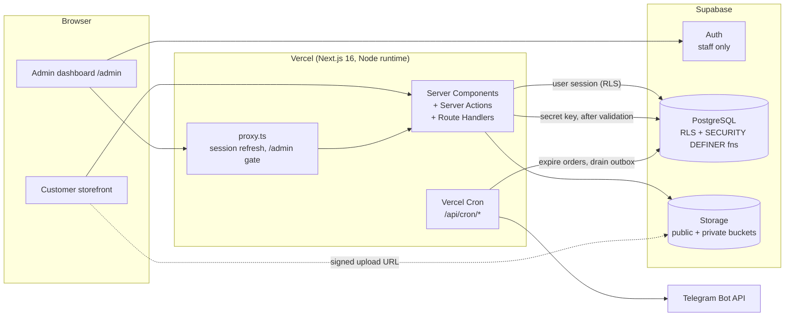
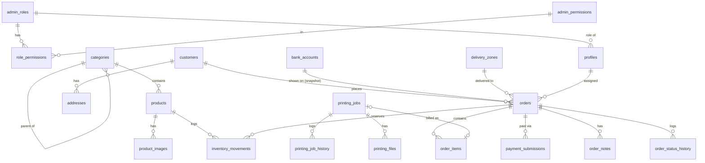
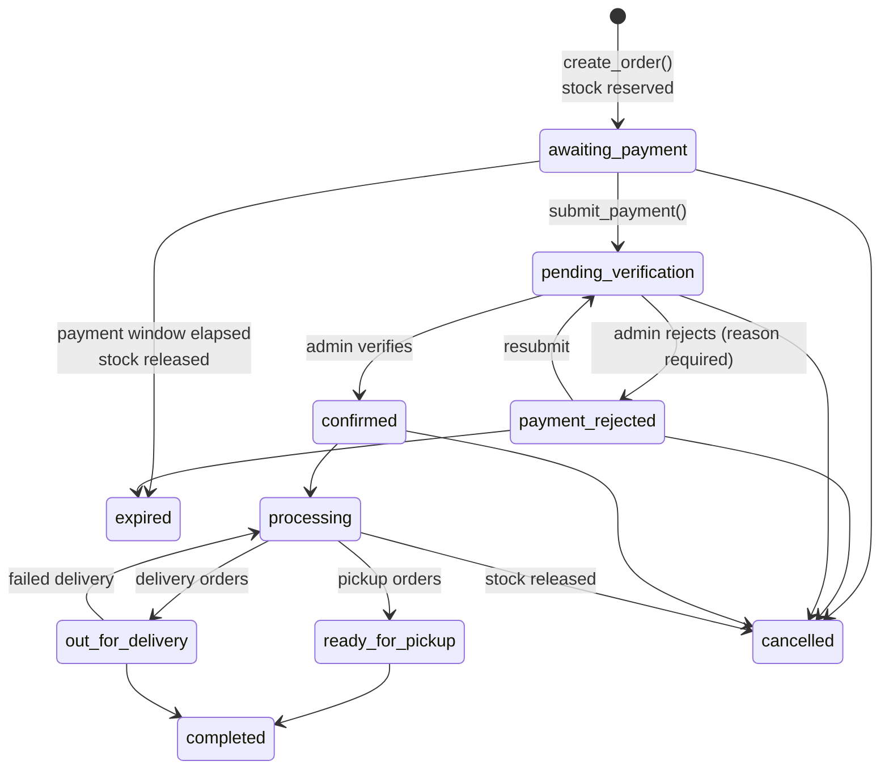

# Technical Architecture

Ethiopian multi-service e-commerce platform: **cosmetics**, **electronics** and **printing services**, with a public storefront and a private admin dashboard in one Next.js application, backed by Supabase.

> Status of each part is tracked in [`PROGRESS.md`](../PROGRESS.md). This document describes the target design; anything marked _(Phase N)_ is designed but not yet built.

---

## 1. System overview

| Concern | Choice | Why |
|---|---|---|
| App | Next.js 16 App Router, TypeScript, React 19 | One deployable for storefront + admin; server-first rendering |
| UI | Tailwind CSS v4, shadcn/ui (new-york), Lucide | Accessible primitives, tokens in CSS variables, easy rebrand |
| Validation | Zod 4 on every server entry point | Same schemas for forms and server |
| DB / Auth | Supabase Postgres + Auth + RLS | Policies enforce access even if app code has a bug |
| Files | Supabase Storage (2 public, 2 private buckets) | Private receipts/documents via short-lived signed URLs |
| i18n | next-intl, cookie-based locale (no URL prefix) | Routes stay exactly as specified (`/shop`, not `/en/shop`) |
| Notifications | Telegram Bot API via a transactional outbox | Orders never depend on Telegram being up |
| Hosting | Vercel + Supabase, custom domain | |

### Trust boundaries

1. **Browser → Next.js server.** Nothing from the browser is trusted: prices, totals, delivery fees, stock and statuses are always recomputed in the database. Inputs are Zod-validated and rate-limited.
2. **Next.js server → Postgres.** Two clients:
   - *User-session client* (publishable key + the admin's cookie session): used for all admin reads/writes, so **RLS applies** on top of the app's own permission checks (defence in depth).
   - *Privileged client* (secret key, `server-only`): used only for guest flows that have no user session — checkout, receipt submission, order lookup by token, printing uploads — and for cron jobs. It calls narrowly scoped `SECURITY DEFINER` functions rather than writing tables directly.
3. **Postgres.** The final authority. Money, stock and status transitions live in transactional SQL functions with row locks. RLS denies by default.

---

## 2. Database design

Migrations: [`supabase/migrations/`](../supabase/migrations). All tables have RLS enabled; default privileges for `anon`/`authenticated` are revoked and every grant is explicit.

| Area | Tables | Notes |
|---|---|---|
| Staff & RBAC | `profiles`, `admin_roles`, `admin_permissions`, `role_permissions` | Customers have **no** accounts (guest checkout). Roles → permissions are data, editable without code changes. |
| Catalog | `categories` (department + parent), `products` (incl. generated `effective_price_etb`), `product_images`, `inventory_movements` | Products are archived, not deleted, once ordered (FK `RESTRICT`). `stock_quantity` can only change via functions — the column is excluded from the `UPDATE` grant. |
| Customers | `customers` (unique normalized phone), `addresses` | Upserted at checkout. |
| Orders | `orders`, `order_items`, `order_status_history`, `order_notes` | Items snapshot name/SKU/unit price. Order snapshots bank details (`bank_snapshot`) so history survives bank edits. CHECK `total = subtotal + delivery − discount`. |
| Payments | `payment_submissions` | One pending submission per order (partial unique index). Reviewer + time recorded. Reused transaction references flagged. |
| Printing | `printing_jobs`, `printing_files`, `printing_job_history`, `printing_price_rules` | Authoritative `total_etb` set by auto-pricing or admin quote; a job cannot be paid before it has one (CHECK). |
| Config | `website_settings` (key → jsonb, `is_public`), `bank_accounts`, `delivery_zones` (spec: *delivery_settings*), `promotions`, `homepage_banners` | Settings shapes validated by Zod (`src/lib/validation/settings.ts`). |
| Operations | `notifications_outbox`, `audit_logs` (append-only), `rate_limits` | Outbox + rate limits are service-role only. |
| Carts | — | Carts live in the browser (`localStorage`, ids + quantities only); the cart page re-reads live prices/stock via a server action, and checkout recomputes everything in the DB, so a `carts` table adds no security. |

### Order lifecycle

`payment_status` (`unpaid → pending_verification → verified | rejected`, `refunded`) is tracked separately. **A receipt never marks an order paid** — only `admin_review_payment(…, 'verified')` by a user holding `payments.verify`.

### Key database functions (`20261118000007_business_functions.sql`)

| Function | Caller | What it guarantees |
|---|---|---|
| `create_order(jsonb)` | server (secret key) | Idempotent per client key; locks product rows in id order (no deadlocks); recomputes prices, delivery fee, free-delivery threshold; reserves stock + logs movements; snapshots bank account; upserts customer. |
| `submit_payment(jsonb)` | server | Verifies order access-token hash; enforces payment deadline; idempotent on same receipt hash; enqueues `new_order` / `payment_resubmitted` notification in the same transaction. |
| `create_printing_job(jsonb)` | server | Files must live under `jobs/<job id>/`; auto-prices when page count known, otherwise `awaiting_quote`. |
| `expire_unpaid_orders()` | cron | `SKIP LOCKED`, releases reserved stock idempotently. |
| `claim_notifications(n)` / `complete_notification(id, ok, err)` | cron worker | `SKIP LOCKED` claims, exponential backoff, `dead` after max attempts. |
| `check_rate_limit(key, limit, window)` | server | Fixed-window counter shared by all serverless instances. |
| `admin_review_payment` | admin (`payments.verify`) | Locks order then submission; reason required to reject; audit + notification. |
| `admin_update_order_status` | admin | State machine above; staff limited to fulfillment on assigned orders; cancel needs `orders.manage` + reason, releases stock. |
| `admin_adjust_stock`, `admin_assign_order`, `admin_quote_printing_job`, `admin_update_printing_status`, `admin_set_staff_role` | admin | Permission-checked; no self-escalation; never removes the last Super Admin. |
| `bootstrap_super_admin(user, name)` | service role only | Works only while no active Super Admin exists. |

Errors are raised as stable codes (e.g. `out_of_stock`) that the app maps to translated messages (`src/lib/errors.ts`, `messages/*.json`).

---

## 3. Security model

### Roles & permissions

| Permission | Super Admin | Manager | Staff |
|---|:-:|:-:|:-:|
| dashboard.view | ✓ | ✓ | ✓ |
| products.view / products.manage / categories.manage | ✓ | ✓ | |
| inventory.manage | ✓ | ✓ | |
| orders.view_all / orders.manage | ✓ | ✓ | |
| orders.view_assigned | ✓ | | ✓ |
| orders.update_fulfillment | ✓ | ✓ | ✓ |
| payments.view / payments.verify | ✓ | ✓ ¹ | |
| printing.view / printing.manage | ✓ | ✓ | ✓ |
| printing.pricing | ✓ | ✓ | |
| customers.view | ✓ | ✓ | |
| reports.operational | ✓ | ✓ | |
| analytics.view (revenue) | ✓ | | |
| promotions.manage | ✓ | ✓ | |
| staff.manage, settings.manage, bank_accounts.manage, audit.view | ✓ | | |

¹ *Decision for the owner:* managers can verify payments by default (they "manage orders"). Remove two rows from `role_permissions` to restrict verification to Super Admins.

### Controls

| Threat | Control |
|---|---|
| Price/total tampering | Browser sends only product ids + quantities; DB recomputes everything. Zod strips unknown keys. |
| Overselling | Row locks (`FOR UPDATE`) + `CHECK (stock_quantity >= 0)`; reservation at order creation, release on cancel/expiry. |
| Order enumeration | `ET-10001` numbers are display-only. Access requires a 256-bit token (order link) or order number + 50-bit tracking code (typed), rate-limited. Only SHA-256 hashes are stored. |
| Unauthorized admin access | `proxy.ts` gate → `requirePermission()` in every page/action → RLS/permission check inside each SQL function. Unauthorized pages return 404. |
| Privilege escalation | Role changes only via `admin_set_staff_role` (needs `staff.manage`, cannot modify self, keeps ≥1 Super Admin). Public sign-ups disabled. |
| Malicious uploads | Type detected from magic bytes, size limits at bucket + app level, server-generated file names, private buckets, signed URLs with short expiry. |
| Large uploads on Vercel (4.5 MB body limit) | Server issues a **signed upload URL** for a server-chosen path; browser uploads directly to the private bucket; server then downloads and verifies content (magic bytes, SHA-256, PDF page count) before calling the DB function. |
| Secret leakage | Secrets only in server env; `server-only` imports; env validated by name (values never logged). |
| XSS | React escaping; the only `dangerouslySetInnerHTML` is product JSON-LD with `<` escaped; Telegram messages sent as escaped HTML. CSP added in Phase 7. |
| CSRF | Server Actions are POST-only with Origin checks (Next.js); admin auth cookies are `SameSite=Lax`. |
| SQL / filter injection | Parameterized PostgREST/RPC calls only; catalog search terms stripped to letters/digits/spaces/hyphens before entering an `or=` filter; `SECURITY DEFINER` functions pin `search_path = ''` and fully qualify objects. |
| Brute force / abuse | `check_rate_limit` on checkout, receipt upload, tracking lookups, printing uploads, admin login. |
| Lost notifications | Transactional outbox; retries with backoff; dedupe key prevents duplicates. |
| Repudiation | Append-only `audit_logs` (trigger blocks UPDATE/DELETE) for bank accounts, settings, prices, roles, payment decisions, stock, status changes. |
| Clickjacking / transport | `X-Frame-Options: DENY`, HSTS, `nosniff`, strict Referrer-Policy, Permissions-Policy. |

---

## 4. Page structure

### Public (no auth)

| Route | Purpose | Data source |
|---|---|---|
| `/` | Hero, departments, featured products, offers, why-us, contact | `website_settings`, `homepage_banners`, `promotions`, products |
| `/shop`, `/cosmetics`, `/electronics` | Catalog with search, category filter, price sort | `products` (RLS: active only) |
| `/printing` | Upload, options, live estimate, add to basket | `printing_price_rules`, `create_printing_job` |
| `/products/[slug]` | Gallery, bilingual description, stock, quantity | `products`, `product_images` |
| `/cart` | Basket (localStorage), totals preview | display mirror `src/lib/pricing/cart.ts` |
| `/checkout` | Contact, fulfillment, review → creates order | `create_order` |
| `/order-success/[orderId]?t=token` | Bank instructions, copy button, receipt upload, tracking code | `submit_payment` |
| `/track-order` | Order number + tracking code → status | rate-limited lookup |
| `/about`, `/contact`, `/privacy`, `/terms` | Content | `website_settings` |

### Admin (`/admin/*`, all server-guarded)

`/admin/login`, `/admin` (dashboard), `/admin/products` (+ `/new`, `/[id]/edit`), `/admin/categories`, `/admin/inventory`, `/admin/orders` (+ `/[id]`), `/admin/payments`, `/admin/printing`, `/admin/customers`, `/admin/analytics`, `/admin/promotions`, `/admin/staff`, `/admin/settings`. Navigation and required permissions: `ADMIN_ROUTES` in `src/lib/auth/permissions.ts`.

### Server endpoints

| Endpoint | Purpose |
|---|---|
| Server Actions | Checkout, payment submission, admin mutations (each re-checks auth) |
| `prepareReceiptUpload` / `submitPaymentProof` (Server Actions) | Signed upload URL for a server-chosen private path, then content verification + `submit_payment` |
| `GET /api/cron/expire-orders` | Vercel Cron, `CRON_SECRET` bearer (constant-time check) |
| `GET /api/cron/notifications` _(Phase 6)_ | Drain the Telegram outbox |
| `GET /api/cron/printing-retention` _(Phase 5)_ | Delete expired printing files |

---

## 5. UI design system

- **Palette** (`src/app/globals.css`): ivory background, deep emerald primary (trust/premium), warm gold accent; department hues — cosmetics rose, electronics blue, printing amber. All colors are OKLCH CSS variables consumed through Tailwind tokens (`bg-primary`, `text-cosmetics`, …). Dark tokens exist for the admin.
- **Typography**: Inter (Latin) + Noto Sans Ethiopic (Ge'ez script), self-hosted via `next/font`; Amharic gets taller line-height.
- **Components**: shadcn/ui (new-york) in `src/components/ui`; status pills via `StatusBadge` (translated + color-coded).
- **Principles**: mobile-first (most Ethiopian shoppers are on phones and slower networks), large tap targets, prices always shown as `4,500 ETB` / `4,500 ብር`, reduced-motion respected, server-rendered pages with minimal client JS.

---

## 6. Internationalization

`next-intl` without URL prefixes. Locale = `NEXT_LOCALE` cookie → `Accept-Language` → English. UI strings in `messages/en.json` / `messages/am.json` (key parity enforced by a unit test). Catalog content is stored bilingually in the DB (`name_en`/`name_am`, …); `localized()` picks the active language with English fallback. Order/payment/printing statuses and every DB error code are translated (enforced by tests).

---

## 7. Testing strategy

| Suite | Command | Covers |
|---|---|---|
| Database | `npm run test:db` | Spins up a throwaway PostgreSQL, emulates Supabase roles/auth/storage, applies all migrations + seed, runs SQL assertions: RLS per role, permissions, checkout pricing, idempotency, oversell, payment review, state machine, expiry, printing, outbox, rate limits, storage policies. |
| Unit | `npm test` | Phone normalization, money, cart & printing price mirrors, tokens, upload sniffing, Zod schemas, TS↔SQL consistency (permissions, error codes, enum translations). |
| Static | `npm run lint`, `npm run typecheck`, `npm run build` | |
| E2E _(Phase 7)_ | Playwright | Checkout → receipt → admin verification on mobile viewports |

---

## 8. Phased implementation plan

| Phase | Scope | Exit criteria |
|---|---|---|
| **1 Planning & foundation** | Architecture, schema + RLS + functions, storage, security model, design tokens, i18n, Supabase clients, auth guards, validation libs, test harnesses | Migrations apply; DB + unit tests, lint, typecheck, build pass |
| **2 Storefront** | Layout (header, search, cart icon, language switcher, footer), homepage from settings, catalog/filter/sort/search, product page, cart (localStorage) | Real data from Supabase, mobile-first, bilingual |
| **3 Checkout** | Checkout form, `create_order` action, bank instructions + copy, signed receipt upload + verification, success page, tracking, expiry cron | Full guest purchase works end-to-end against Supabase |
| **4 Admin** | Login, layout, dashboard, products/images, categories, inventory, orders, payments review (signed receipt URLs), customers, staff invites, settings, super-admin bootstrap script | Each role verified against the permission matrix |
| **5 Printing** | Upload + PDF page counting, options & live estimate, quotes, job management, retention cron | Auto-priced and quoted flows work end-to-end |
| **6 Telegram** | Bot service, outbox worker (cron), receipt attachment, failure handling | Notifications delivered; outages retried without data loss |
| **7 Finalization** | Promotions/analytics polish, CSP, security review, E2E + mobile testing, deployment docs, production checklist | Production deploy on custom domain |
